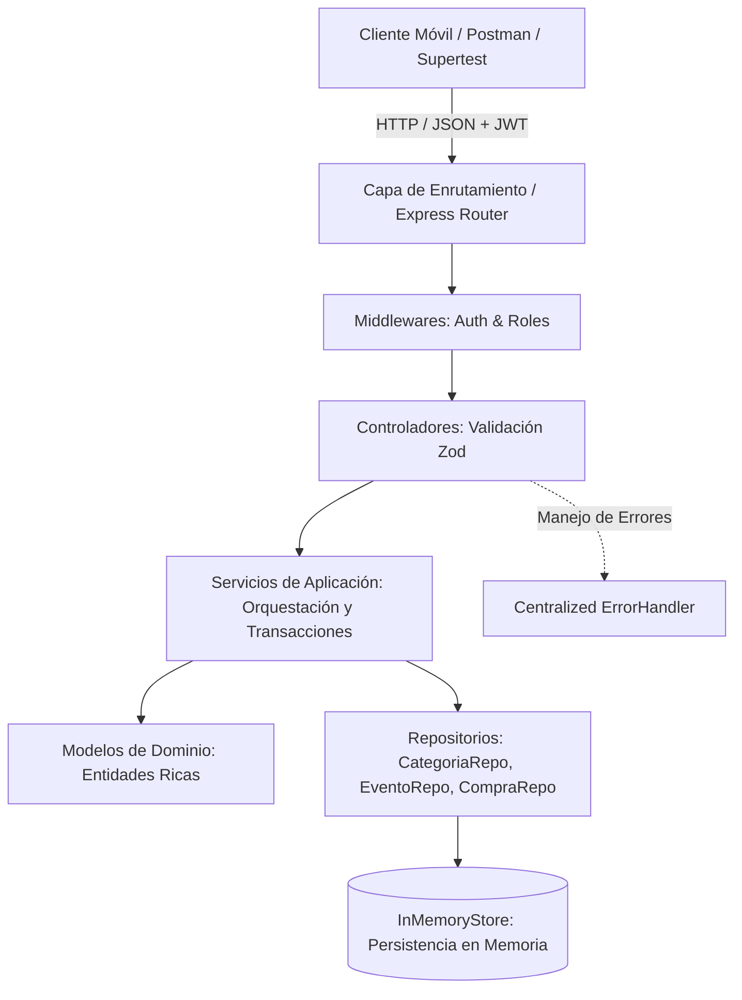
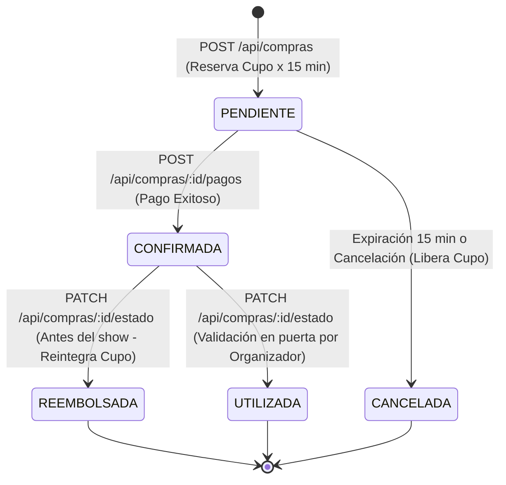

# 📐 Registro de Decisiones de Diseño y Arquitectura (ADR)
## AI Ticket It — Plataforma de Venta de Entradas para Eventos
**Cátedra:** Diseño de Sistemas (DDS) — UTN FRBA — 2C 2026  
**Trabajo Práctico Individual de Desarrollo con Inteligencia Artificial**

---

## 📑 Índice de Contenidos
1. [Introducción y Objetivos](#1-introducción-y-objetivos)
2. [Estrategia General y Pivot de Sprints](#2-estrategia-general-y-pivot-de-sprints)
3. [Arquitectura de Software y Patrones de Diseño](#3-arquitectura-de-software-y-patrones-de-diseño)
4. [Decisiones del Dominio y Casos de Uso (Sprint 3)](#4-decisiones-del-dominio-y-casos-de-uso-sprint-3)
   - [4.1. Flujo Transaccional de Compras en Dos Pasos y Cupos Temporales](#41-flujo-transaccional-de-compras-en-dos-pasos-y-cupos-temporales)
   - [4.2. Modelado de Auditoría como Raíz de Agregado (DDD)](#42-modelado-de-auditoría-como-raíz-de-agregado-ddd)
   - [4.3. Diseño de la API: REST Puro vs. Verbos en las Rutas](#43-diseño-de-la-api-rest-puro-vs-verbos-en-las-rutas)
   - [4.4. Tipos de Entrada Segmentados y Criterio de Ordenamiento por Precio](#44-tipos-de-entrada-segmentados-y-criterio-de-ordenamiento-por-precio)
   - [4.5. Cálculo Dinámico de Días Faltantes (CU-01) y Casos de Borde](#45-cálculo-dinámico-de-días-faltantes-cu-01-y-casos-de-borde)
   - [4.6. Autorización Estricta en la Consulta de Ventas del Organizador (CU-02)](#46-autorización-estricta-en-la-consulta-de-ventas-del-organizador-cu-02)
   - [4.7. Circuito de Cancelación y Reembolso con Reintegro de Cupos (CU-07, CU-08)](#47-circuito-de-cancelación-y-reembolso-con-reintegro-de-cupos-cu-07-cu-08)
5. [Decisiones de la Capa Frontend Mobile (Expo React Native)](#5-decisiones-de-la-capa-frontend-mobile-expo-react-native)
6. [Estrategia de Testing y Verificación de Calidad](#6-estrategia-de-testing-y-verificación-de-calidad)
7. [Matriz de Trazabilidad: Casos de Uso vs. Componentes](#7-matriz-de-trazabilidad-casos-de-uso-vs-componentes)

---

## 1. Introducción y Objetivos
El presente documento tiene como finalidad registrar y fundamentar formalmente las decisiones de diseño arquitectónicas, técnicas y de modelado de dominio adoptadas durante la construcción de la plataforma **AI Ticket It**.

El proyecto se diseñó bajo los paradigmas centrales enseñados en **Diseño de Sistemas (DDS)**:
- **Alta Cohesión y Bajo Acoplamiento**.
- **Modelos de Dominio Ricos** (*Rich Domain Models*), evitando modelos anémicos y encapsulando reglas de negocio dentro de las entidades.
- **Principios SOLID** (en particular Responsabilidad Única, Inversión de Dependencias y Sustitución de Liskov).
- **Separación de Responsabilidades** estricta entre presentación, orquestación, lógica de negocio y persistencia.

---

## 2. Estrategia General y Pivot de Sprints

### 2.1. Reordenamiento: Backend-First (Sprints 3 y 4 antes de Frontend)
- **Decisión:** Modificar el orden original de los sprints para completar el 100% de la lógica y los endpoints del Backend (Sprint 3: Core y Transaccional; Sprint 4: Social, Chat y Reseñas) antes de avanzar con la interfaz de usuario en React Native (Sprints 5 y 6).
- **Fundamentos:**
  1. **Contrato de API Estable:** Diseñar e implementar el backend primero fija contratos REST sólidos (esquemas Zod, códigos de estado HTTP, estructura de respuestas JSON) y elimina la incertidumbre al momento de maquetar el frontend.
  2. **Validación Exhaustiva con Tests Automatizados:** Los casos de uso de alta sensibilidad (cupos atómicos, auditoría de estados, prevención de sobreventa y cancelaciones) pueden ser probados de punta a punta con tests de integración (Supertest) sin depender de emuladores ni componentes visuales.
  3. **Desarrollo de UI Ágil y sin Mockeado:** Cuando se desarrollen las pantallas móviles, el backend ya contará con datos semilla realistas y servicios activos, reduciendo el retrabajo visual y la necesidad de *mock servers* temporales.

### 2.2. Monorepo con Git Flow Estricto
- **Decisión:** Trabajar sobre un monorepo (`packages/backend` y `packages/frontend`) manteniendo ramas de integración independientes (`main` y `develop`), ramas de funcionalidad (`feature/<nombre>`), fusiones explícitas con `--no-ff` y mensajes de commit bajo el estándar **Conventional Commits**.
- **Fundamentos:** Garantiza trazabilidad histórica, aislamiento de cambios por caso de uso y previene regresiones en la rama principal.

---

## 3. Arquitectura de Software y Patrones de Diseño



### 3.1. Arquitectura en Capas (Layered Architecture)
El backend se estructura en 5 capas claramente delimitadas:
1. **Capa de Dominio (`src/models/`):** Clases JavaScript nativas (`Usuario`, `Evento`, `TipoEntrada`, `Compra`, `CambioEstadoCompra`, `Categoria`) que contienen los atributos y métodos con la lógica de negocio pura. No tienen acoplamiento con Express, JWT ni librerías de persistencia.
2. **Capa de Persistencia (`src/repositories/`):** Abstracciones de acceso a datos (`*Repository.js`) que interactúan con `InMemoryStore`. Si a futuro se migra a PostgreSQL/MongoDB, solo cambia la implementación de los repositorios sin alterar el dominio ni los servicios.
3. **Capa de Servicios de Aplicación (`src/services/`):** Clases que orquestan el flujo entre repositorios y entidades de dominio, asegurando consistencia de datos, permisos y reglas de negocio inter-agregados.
4. **Capa de Controladores y Validación (`src/controllers/`):** Adaptadores de entrada que reciben solicitudes HTTP, validan la estructura mediante **Zod** y delegan la ejecución al servicio correspondiente.
5. **Capa de Enrutamiento y Middleware (`src/routes/`, `src/middlewares/`):** Declaración declarativa de rutas y filtros transversales de autenticación JWT y autorización basada en roles (`requireRole`).

### 3.2. Validación Semántica vs. Validación Estructural
- **Decisión:** Separar la validación en dos niveles:
  1. *Estructural (Capa de Transporte):* Zod valida tipos de datos, presencia de campos obligatorios y formato JSON en el controlador. Ante un error sintáctico, responde con `400 Bad Request`.
  2. *Semántica (Capa de Dominio y Servicios):* Las entidades y servicios validan reglas del negocio (ej. "el cupo solicitado supera el disponible", "la fecha del evento debe ser futura", "no se puede cancelar un evento ya realizado"). Ante un incumplimiento de reglas, se lanza `UnprocessableEntityError` y se responde con `422 Unprocessable Entity`.
- **Fundamento:** Respeta el principio de *Fail-Fast* y mantiene al dominio como la única fuente de verdad sobre las invariantes del negocio.

### 3.3. Manejo Centralizado de Errores (`AppError`)
- **Decisión:** Jerarquía polimórfica de errores que heredan de `AppError` (`BadRequestError` [400], `UnauthorizedError` [401], `ForbiddenError` [403], `NotFoundError` [404], `ConflictError` [409], `UnprocessableEntityError` [422]).
- **Fundamento:** Elimina el uso repetitivo de `res.status(X).json(...)` en bloques `catch` de los controladores. Cualquier excepción se propaga mediante `next(error)` al `errorHandler`, garantizando respuestas homogéneas con `{ status, statusCode, message, timestamp }`.

---

## 4. Decisiones del Dominio y Casos de Uso (Sprint 3)

### 4.1. Flujo Transaccional de Compras en Dos Pasos y Cupos Temporales
- **Problema de Diseño:** Si una compra se crea directamente en estado `CONFIRMADA` sin simular el paso de pago, el modelo no representa la realidad operativa de los sistemas de ticketing (donde existe un tiempo de procesamiento de pago). Si la compra no reserva cupo inmediatamente, dos compradores concurrentes podrían intentar comprar la última entrada disponible y fallar al pagar (*overselling*).
- **Decisión:**
  1. `POST /api/compras` crea la compra en estado **`PENDIENTE`** y **descuenta inmediatamente el cupo** disponible del tipo de entrada seleccionado.
  2. La compra se inicializa con una ventana de reserva de **15 minutos** (`fechaExpiracion = fechaCompra + 15 min`).
  3. El comprador confirma la adquisición mediante `POST /api/compras/:id/pagos`, lo cual transiciona el estado a **`CONFIRMADA`**.
  4. Si transcurren los 15 minutos sin registrarse el pago, al intentar pagar o al listar las compras, el sistema detecta la expiración pasiva (`compra.haExpirado()`), transiciona la compra a **`CANCELADA`** y **reintegra automáticamente el cupo** disponible al evento (`tipoEntrada.reintegrarCupo(cantidad)`).
- **Fundamento:** Replica el comportamiento de plataformas de escala internacional (Ticketmaster, Eventbrite), protegiendo la consistencia de inventario y garantizando equidad entre compradores sin sobreventa.



---

### 4.2. Modelado de Auditoría como Raíz de Agregado (DDD)
- **Problema de Diseño:** ¿Dónde y cómo persistir el historial de transiciones de una compra (`CambioEstadoCompra`)? ¿En una colección o repositorio separado, o encapsulado dentro de la propia compra?
- **Decisión:** Aplicar el patrón **Aggregate Root** de Domain-Driven Design:
  - La entidad `Compra` es la Raíz de Agregado.
  - La compra encapsula internamente su colección `historialEstados: [CambioEstadoCompra]`.
  - La única forma válida de alterar el estado de una compra es invocando el método de dominio `compra.actualizarEstado(nuevoEstado, quienId, motivo)`. Este método verifica la matriz de transiciones permitidas, actualiza el estado actual e instancia y almacena un nuevo `CambioEstadoCompra` en su historial.
- **Fundamento:** 
  - **Alta Cohesión:** La compra y su ciclo de vida forman una unidad atómica.
  - **Eficiencia de Consulta:** Cuando el cliente consulta `GET /api/compras/mis-compras` o `GET /api/compras/:id`, recibe directamente el *timeline* completo de la compra sin requerir *joins* adicionales en memoria.
  - **Invariantes protegidos:** No es posible modificar el estado de una compra sin que quede registrado quién lo hizo, en qué fecha y bajo qué justificación.

---

### 4.3. Diseño de la API: REST Puro vs. Verbos en las Rutas
- **Problema de Diseño:** La consigna menciona acciones como "cancelar", "reembolsar" y "utilizar". En arquitecturas RPC se acostumbra usar verbos en la URI (ej. `POST /api/compras/:id/cancelar` o `PATCH /api/compras/:id/utilizar`), lo cual viola la restricción REST donde las URIs deben representar exclusivamente **sustantivos / recursos**.
- **Decisión:** Diseñar la API bajo los principios de **REST Puro (Nivel 2 del Modelo de Madurez de Richardson)**:
  - **Modificación de Estado:** Se expone el endpoint uniforme `PATCH /api/compras/:id/estado`, donde el cliente envía en el cuerpo de la petición el nuevo estado deseado y el motivo opcional:
    ```json
    PATCH /api/compras/comp-1/estado
    {
      "estado": "REEMBOLSADA",
      "motivo": "Imposibilidad de asistir por razones personales"
    }
    ```
  - **Creación de Transacciones/Pagos:** El registro del pago se modela como la creación de un recurso dependiente: `POST /api/compras/:id/pagos`.
- **Fundamento:** Estandarización de la interfaz, uso idiomático de los verbos HTTP (`PATCH` para modificaciones parciales de recursos existentes, `POST` para creación de recursos subordinados) y mantenibilidad a largo plazo.

---

### 4.4. Tipos de Entrada Segmentados y Criterio de Ordenamiento por Precio
- **Problema de Diseño:** Un evento puede tener múltiples tipos de entrada con precios disímiles (ej. Popular $10.000 vs. VIP $35.000). Al solicitar el catálogo ordenado por precio (`?sortBy=precio`), ¿cuál precio determina la posición del evento?
- **Decisión:**
  - El método de dominio `evento.precioMinimo()` calcula el menor precio disponible entre todos sus tipos de entrada.
  - El ordenamiento por precio (`sortBy=precio&order=asc|desc`) utiliza `precioMinimo()` como criterio de ordenación.
  - Los filtros de rango (`minPrecio` y `maxPrecio`) evalúan `evento.tuPrecioEstaEntre(min, max)`, verificando si al menos un tipo de entrada encaja en el presupuesto solicitado por el usuario.
- **Fundamento:** Es el estándar universal de UX en comercio electrónico y venta de tickets (*"Entradas desde $X"*), permitiendo a los compradores encontrar las opciones más accesibles en primer término.

---

### 4.5. Cálculo Dinámico de Días Faltantes (CU-01) y Casos de Borde
- **Problema de Diseño:** La consigna establece que el comprador debe poder *"visualizar cuántos días faltan para el evento en caso de estar en estado confirmada"*. ¿Debe persistirse este valor o calcularse al vuelo? ¿Cómo tratar eventos pasados o estados no confirmados?
- **Decisión:**
  - El cálculo es **100% dinámico**, ejecutado en memoria durante la consulta mediante `compra.calcularDiasFaltantes(evento.fecha, ahora)`:
    $$\text{días} = \left\lceil \frac{\text{fechaEvento} - \text{ahora}}{1000 \times 60 \times 60 \times 24} \right\rceil$$
  - **Casos de borde cubiertos:**
    1. *Compra NO confirmada* (ej. `PENDIENTE`, `CANCELADA`, `REEMBOLSADA`, `UTILIZADA`): Devuelve `diasFaltantes: null` y `eventoFinalizado: null`.
    2. *Evento futuro:* Devuelve `diasFaltantes: N` (entero positivo) y `eventoFinalizado: false`.
    3. *Evento el mismo día:* Devuelve `diasFaltantes: 0` y `eventoFinalizado: false`.
    4. *Evento ya transcurrido:* Devuelve `diasFaltantes: 0` y `eventoFinalizado: true`.
- **Fundamento:** Persistir una cantidad de días en la base de datos genera datos obsoletos pasadas las 24 horas. El cálculo dinámico garantiza exactitud matemática sin cron jobs de sincronización.

---

### 4.6. Autorización Estricta en la Consulta de Ventas del Organizador (CU-02)
- **Problema de Diseño:** El endpoint `GET /api/eventos/:id/compras` permite al organizador supervisar las ventas y cupos restantes de un evento. ¿Cualquier usuario con rol `ORGANIZADOR` puede ver cualquier evento?
- **Decisión:** Aplicar el principio de **Mínimo Privilegio y Control de Acceso Basado en Propiedad (ABAC / Attribute-Based Access Control)**:
  - El middleware `requireRole(RolUsuario.ORGANIZADOR)` valida que el usuario sea organizador.
  - El servicio `CompraService.obtenerComprasDeEvento(eventoId, organizadorId)` valida que `evento.organizadorId === organizadorId`. Si otro organizador intenta acceder, se responde inmediatamente con `403 Forbidden`.
  - La respuesta desglosa:
    - Cantidad de entradas vendidas por tipo de entrada.
    - Cupos disponibles y cupos totales actualizados.
    - Recaudación total acumulada (solo de compras en estado `CONFIRMADA` o `UTILIZADA`).
    - Listado de compras con datos del comprador titular (nombre, apellido, email).
- **Fundamento:** Protege la privacidad y confidencialidad comercial entre diferentes productores y organizadores que coexisten en la plataforma.

---

### 4.7. Circuito de Cancelación y Reembolso con Reintegro de Cupos (CU-07, CU-08)
- **Problema de Diseño:** ¿Bajo qué condiciones un comprador puede cancelar una compra y cuándo debe restituirse el cupo?
- **Decisión:**
  - El método `CompraService.actualizarEstado` verifica:
    1. **Identidad:** Solo el comprador titular o el organizador pueden cancelar.
    2. **Estado previo:** No se permite cancelar una compra que ya fue utilizada (`UTILIZADA`). Si se intenta, se rechaza con `422 Unprocessable Entity`.
    3. **Vigencia temporal:** No se permite cancelar ni reembolsar si el evento ya se realizó (`!evento.esFechaFutura()`).
  - Al procesarse la cancelación o reembolso exitoso, el sistema invoca inmediatamente `tipoEntrada.reintegrarCupo(compra.cantidad)` y persiste tanto la compra como el evento actualizado.
- **Fundamento:** Cumplimiento estricto de las reglas de negocio de la consigna (**CU-07 y CU-08**), previniendo fraudes (reclamar reembolso luego de ingresar al show) y garantizando que las entradas devueltas vuelvan a estar disponibles para otros compradores.

---

---

## 5. Decisiones de la Capa de Comunicación, Reseñas y Reputación (Sprint 4)

### 5.1. Chat Bidireccional en Compras (CU-05, CU-06)
- **Problema de Diseño:** El comprador y el organizador necesitan comunicarse para coordinar detalles (accesos, horarios, dudas). ¿Cómo modelar el canal de mensajes y quiénes tienen permiso para participar?
- **Decisión:**
  - **Subrecurso REST Anidado:** Se monta sobre `/api/compras/:id/mensajes`. Un mensaje pertenece ontológicamente al contexto de una compra específica (`compraId`).
  - **Control de Acceso Estricto (CU-05, CU-06):**
    - Solo el **comprador titular** (`compra.compradorId === usuarioId`) o el **organizador dueño del evento** (`evento.organizadorId === usuarioId`) pueden leer el historial o enviar mensajes. Usuarios ajenos reciben `403 Forbidden`.
  - **Ciclo de Vida y Transiciones:**
    - Se permite el envío de mensajes mientras la compra se encuentra en estados activos: `PENDIENTE`, `CONFIRMADA` o `UTILIZADA`.
    - Si la compra pasa a `CANCELADA` o `REEMBOLSADA`, el canal pasa a modo **solo lectura**: se puede consultar el historial histórico, pero cualquier intento de envío de nuevos mensajes es rechazado con `422 Unprocessable Entity` ("No es posible enviar mensajes en una compra cancelada o reembolsada").
  - **Enriquecimiento del Remitente en la Respuesta:**
    - Cada mensaje devuelto incluye el objeto `remitente` (`id`, `nombre`, `apellido`, `rol`). Esto permite a la interfaz móvil renderizar avatares y burbujas de diálogo sin requerir múltiples consultas adicionales al backend.

---

### 5.2. Sistema de Reseñas Post-Evento y Elegibilidad Estricta (CU-09)
- **Problema de Diseño:** ¿Quiénes pueden calificar un evento y cómo se garantiza la autenticidad de las opiniones sin spam o calificaciones ficticias?
- **Decisión:**
  - **Elegibilidad Estricta (Proof of Attendance):** Solo los usuarios con rol `COMPRADOR` que posean al menos una compra en estado `UTILIZADA` para ese evento específico pueden emitir una reseña. Si no tienen una compra utilizada, se rechaza con `422 Unprocessable Entity` ("Solo puedes calificar un evento si posees una entrada en estado UTILIZADA").
  - **Garantía de Unicidad:** Un comprador solo puede emitir una única reseña por evento. Si intenta enviar una segunda calificación, el backend responde con `409 Conflict` ("Ya has emitido una reseña para este evento").
  - **Reglas de Dominio del Modelo `Resenia`:**
    - Puntuación numérica en rango [1.0, 5.0], redondeada a un decimal (`Math.round(puntuacion * 10) / 10`).
    - Comentario textual obligatorio (`detalle`) no vacío (mínimo 1 carácter, máximo 1000).
    - Timestamp de emisión automático en formato ISO-8601.

---

### 5.3. Reputación Consolidada del Organizador y Ordenamiento Reactivo (CU-10, CU-11)
- **Problema de Diseño:** ¿Cómo se calcula la reputación del organizador y cómo impacta en las búsquedas del catálogo (`GET /api/eventos?sortBy=puntaje`)?
- **Decisión:**
  - **Reputación Global por Organizador:** La reputación de un organizador es el promedio aritmético de todas las reseñas recibidas a lo largo de todos sus eventos finalizados. Si un organizador no posee reseñas previas, su reputación es `null` y `totalResenias: 0`.
  - **Propagación Reactiva:** Cuando un comprador envía una reseña válida, el servicio `ReseniaService` calcula inmediatamente la nueva reputación del organizador y actualiza el campo `puntajePromedio` en todos los eventos de ese organizador en el repositorio en memoria.
  - **Enriquecimiento en Detalle de Evento (`GET /api/eventos/:id`):** Devuelve `organizador.reputacion`, `organizador.totalResenias` y las 5 reseñas más recientes de eventos anteriores (`reseniasAnteriores`), permitiendo a los compradores informarse antes de comprar entradas.
  - **Ordenamiento Consistente:** En `GET /api/eventos?sortBy=puntaje&order=desc`, los eventos de organizadores con mayor reputación aparecen primero, posicionando al final los eventos sin calificaciones previas.

---

### 5.4. Documentación Interactiva de la API con OpenAPI 3.0 / Swagger UI
- **Decisión:** Documentar el 100% de los endpoints de la API utilizando la especificación OpenAPI 3.0 mediante `swagger-ui-express`, disponible en las rutas `/api-docs` y `/api/docs`.
- **Características:**
  - Soporte interactivo para el esquema de seguridad `BearerAuth` con token JWT.
  - Modelos y esquemas de respuesta tipados con ejemplos realistas (`Usuario`, `Evento`, `Compra`, `Mensaje`, `Resenia`, `ReputacionOrganizadorResponse`).
  - Catálogo completo de códigos de estado HTTP (200, 201, 400, 401, 403, 404, 409, 422, 500) con mensajes descriptivos.

---

## 6. Decisiones de la Capa Frontend Mobile (Expo React Native)

### 6.1. Expo SDK 52 y Soporte Web Unificado
- **Decisión:** Desarrollar sobre Expo React Native con Metro bundler, garantizando ejecución nativa en dispositivos móviles (iOS/Android mediante Expo Go) y navegador web para desarrollo rápido.
- **Solución a Gotchas de React Native Web:**
  - Configuración del elemento raíz `#root` en `packages/frontend/public/index.html` con `height: 100%; display: flex; flex-direction: column;` para evitar el colapso a 0px de altura (pantalla blanca).
  - Reemplazo de tokens no estándar (`%PUBLIC_URL%`) para evitar excepciones en el parser de Metro bundler.
  - Uso condicional de `KeyboardAvoidingView` según la plataforma (`Platform.OS === 'ios' ? 'padding' : undefined`) para evitar roturas de layout en navegadores de escritorio.

### 6.2. Modal Personalizado de Confirmación (`ConfirmModal`)
- **Decisión:** Eliminar el uso de `window.confirm()` del navegador y `Alert.alert()` nativo en favor de un componente UI React Native propio: [ConfirmModal.js](file:///Users/francoball/Estudio/UTN/3año/DDS/TP-Individual/tp-dds-2026-AI-Ticket-It/packages/frontend/src/components/ui/ConfirmModal.js).
- **Fundamento:** Los diálogos nativos del navegador se cierran inesperadamente en entornos iframe o pierden el foco en web, generando inconsistencias al cerrar sesión o cancelar compras. El modal personalizado provee un backdrop oscuro elegante, accesibilidad y consistencia visual en todas las plataformas.

### 6.3. Identidad Visual Oficial de la Cátedra
- **Decisión:** Paleta de diseño basada en el logo oficial provisto en `docs/logo_catedra.png`:
  - Color Primario Marca: Verde Ticket It `#55d233`.
  - Fondo y Superficies: Modo Oscuro con escala de grises slate (`#0f172a`, `#1e293b`, `#334155`).
  - Acentos por Rol: Celeste `#0284c7` para **Comprador** y Ámbar `#f59e0b` para **Organizador**.

---

## 7. Estrategia de Testing y Verificación de Calidad

```
               /\
              /  \      Integration Tests (Supertest)
             /    \     Endpoints REST, Auth JWT, Permisos, Códigos HTTP
            /------\
           /        \   Unit Tests (Jest)
          /          \  Modelos de Dominio, Invariantes, Cálculo de Cupos y Días
         /------------\
```

- **Tests Unitarios de Dominio (Sin Mocks):**
  - Prueban exhaustivamente la lógica pura de negocio: `Usuario.test.js`, `Categoria.test.js`, `TipoEntrada.test.js`, `Evento.test.js`, `Compra.test.js`, `CambioEstadoCompra.test.js`, `Mensaje.test.js` y `Resenia.test.js`.
  - Verifican decremento de cupos, errores por falta de disponibilidad, transiciones de estado válidas e inválidas, unicidad de reseñas, cálculo de reputación y serialización `toJSON()`.
- **Tests de Integración de Endpoints (Supertest + Express):**
  - `auth.test.js`: Registro, login, emisión y validación de tokens JWT.
  - `eventos.test.js`: Catálogo público, búsqueda textual, filtros por categoría y precio, ordenamientos ascendente y descendente, y permisos de publicación para organizadores.
  - `compras.test.js`: Flujo transaccional completo: reserva en `PENDIENTE`, pago a `CONFIRMADA`, consulta de `mis-compras` con días faltantes, panel de compras de organizador con cupos restantes, reembolsos con restitución de stock y rechazo de reembolsos para entradas ya utilizadas.
  - `chat.test.js`: Envío de mensajes de comprador y organizador, bloqueo a usuarios ajenos con 403, restricción de escritura en compras reembolsadas con 422, e historial cronológico con remitentes.
  - `resenias.test.js`: Requisito de entrada `UTILIZADA`, rechazo con 422 para no asistentes, prevención de reseñas duplicadas con 409, cálculo de reputación del organizador y ordenamiento en catálogo por puntaje (`sortBy=puntaje`).
- **Resultados:** 15 suites de test ejecutadas con **100% de éxito (109 tests pasando)** y **0 advertencias en ESLint**.

---

## 8. Matriz de Trazabilidad: Casos de Uso vs. Componentes

| Caso de Uso | Descripción Resumida | Implementación Backend | Endpoint / Método |
| :--- | :--- | :--- | :--- |
| **CU-01** | Comprador visualiza compras con estado y días faltantes | `Compra.calcularDiasFaltantes()`, `CompraService.obtenerMisCompras()` | `GET /api/compras/mis-compras` |
| **CU-02** | Organizador visualiza compras de evento y cupos restantes de cada tipo | `CompraService.obtenerComprasDeEvento()` | `GET /api/eventos/:id/compras` |
| **CU-03** | Comprador busca eventos por texto o explora por categoría | `EventoRepository.buscarTodos()`, `CategoriaService.listarTodas()` | `GET /api/eventos?q=...&categoria=...`, `GET /api/categorias` |
| **CU-04** | Organizador crea evento con múltiples tipos de entrada, precios y cupos | `EventoService.crearEvento()`, `TipoEntrada` | `POST /api/eventos` |
| **CU-05** | Comprador envía mensajes sobre una compra (chat) | `ChatService.enviarMensaje()`, `Mensaje` | `POST /api/compras/:id/mensajes` |
| **CU-06** | Organizador responde mensajes sobre una compra (chat) | `ChatService.enviarMensaje()`, `ChatService.obtenerHistorial()` | `POST /api/compras/:id/mensajes`, `GET /api/compras/:id/mensajes` |
| **CU-07** | Comprador cancela compra para obtener reembolso | `CompraService.actualizarEstado()`, `TipoEntrada.reintegrarCupo()` | `PATCH /api/compras/:id/estado` (`REEMBOLSADA`) |
| **CU-08** | Restricción: solo cancelar si no está utilizada y evento no se realizó | Validaciones en `CompraService.actualizarEstado()` | `PATCH /api/compras/:id/estado` |
| **CU-09** | Comprador puntúa y comenta evento con entrada UTILIZADA | `ReseniaService.crearResenia()`, `Resenia` | `POST /api/eventos/:id/resenias` |
| **CU-10** | Reseñas históricas y reputación se visualizan en eventos y organizador | `ReseniaService.obtenerReseniasDeOrganizador()`, `EventoService.obtenerPorId()` | `GET /api/organizadores/:id/resenias`, `GET /api/eventos/:id` |
| **CU-11** | Comprador ordena eventos por precio, fecha y puntaje | `EventoRepository.buscarTodos()` con lógica de ordenamiento | `GET /api/eventos?sortBy=precio\|fecha\|puntaje&order=asc\|desc` |
| **CU-12** | Comprador compra entrada seleccionando tipo y cantidad sin superar cupo | `TipoEntrada.decrementarCupo()`, `CompraService.crearCompra()` | `POST /api/compras` |

